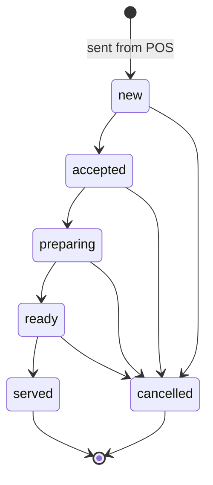
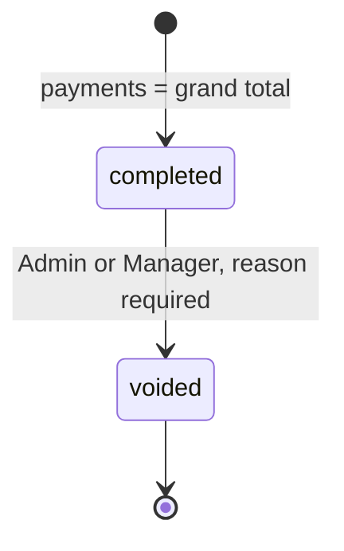
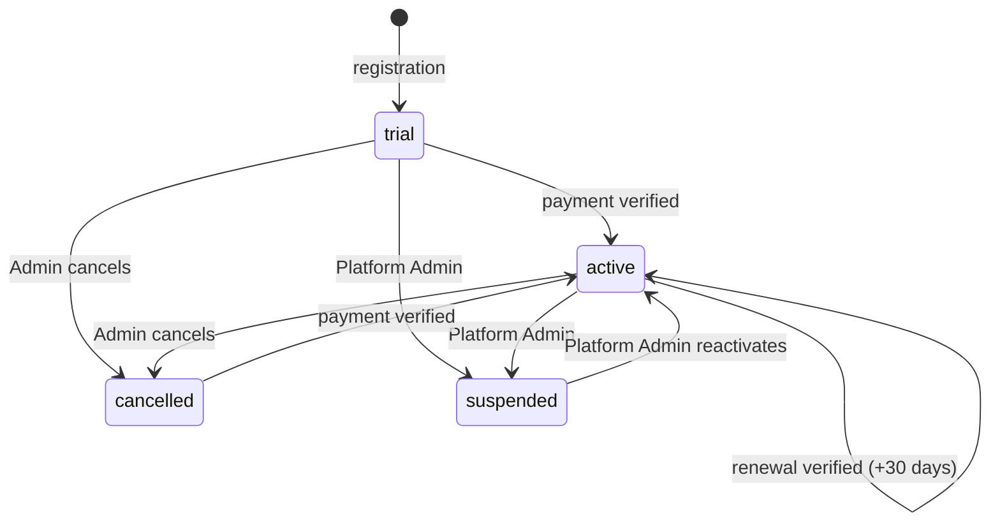

# Business Rules — POS SYSTEM

Exact logic for v1. Where v1 deliberately differs from the prototype, the rule says **(prototype: …)** so the agent doesn't "fix" it back. All money logic lives in one shared module (`packages/shared/src/money/`, see `04-ARCHITECTURE.md` §5) and is used by both the POS screen (preview) and the API (authoritative).

## 1. Glossary

| Term | Exact meaning in this app |
|---|---|
| Business | A subscribing company (tenant). Every record except platform data belongs to exactly one business. |
| Business ID | Public code `BIZ-XXXXX` shown in the top bar and usable at sign-in. Not the database primary key. |
| Employee | A person who signs in inside a business, with one role. The prototype calls them "users". |
| Sale | A completed or voided checkout. The UI calls it an **invoice**; the prototype calls it a "transaction". Stored in `sales`. |
| Line | One product in a cart or sale, with quantity. |
| Line discount | Nu. amount typed by the cashier on a single line. |
| Customer-type discount | Automatic % discount for the selected customer's type (e.g. VIP 5%), set in Settings (BR-34). |
| Bill discount | Optional % or Nu. discount on the whole bill, typed at the POS. |
| Allocated discount | The customer-type discount plus bill discount, spread across lines before tax (BR-13). |
| Charges | Extra Nu. amount added after tax (e.g. delivery or packing). Not taxed (BR-15). |
| Grand total | What the customer owes for the sale: sum of line totals plus charges. |
| Payment line | One method + amount used to pay a sale. A sale can have several (split payment). |
| Credit | The part of a sale the customer will pay later. Recorded as a payment line with method `credit`. |
| Outstanding balance | Total credit a customer still owes. |
| Credit settlement | A payment a customer makes against their outstanding balance. Has its own receipt number `CR-NNNN`. |
| Kitchen order (KOT) | Restaurant ticket sent to the kitchen before billing. |
| Held order | A cart parked at the POS to be resumed later. Not a sale. |
| Void | Cancelling a completed sale. The invoice keeps its number and stays on record. |
| Stock movement | Any change to a product's stock, with type, signed quantity and reason. |
| Tracked product | A product whose stock is counted and decreases on sale (`track_stock = true`). |
| Business day | Calendar date in Asia/Thimphu (UTC+6) when something happened. Reports filter on it. |
| Chhertum | 1/100 of a Ngultrum. All money is exact to the chhertum. |
| TPN / GST no. | The business's (or customer's) taxpayer number printed on invoices. Stored as `gst_no` / `gst_id`. |

## 2. Rules

| ID | Rule | Applies to | Example |
|---|---|---|---|
| BR-01 | Business names are unique across the platform, ignoring case and surrounding spaces. Company sign-in accepts the business name or the Business ID, case-insensitive. Business ID format is `BIZ-` + 5 uppercase letters/digits, generated at registration and never changed. | F-01, F-03 | "pema store" signs in to "Pema Store" (BIZ-7Q2KD). |
| BR-02 | Employee usernames are unique within a business, ignoring case. A business must always have at least one active Admin: disabling, or changing the role of, the last active Admin is rejected. No admin account is ever created automatically at sign-in **(prototype: `handleEmployeeLogin` auto-creates `admin` — removed)**. | F-03, F-04 | Creating "Cashier1" when "cashier1" exists → error "Username already taken". |
| BR-03 | Registration creates the business, its first Admin employee (username `admin`, the password given at registration), default tax rates (BR-10) and a subscription on the chosen plan with status `trial`, expiring 14 days later. **(Prototype: simulated card payment made it `active` immediately.)** | F-01, F-02 | Registered 2026-11-01 10:00 → trial until 2026-11-15 10:00. |
| BR-04 | Effective subscription status is computed, never stored as "expired": if status is `cancelled` or `suspended` → that status; else if `expires_at` < now → **Expired**; else the stored status (`trial` or `active`). | F-02 | status `active`, expires yesterday → shown as Expired. |
| BR-05 | When the effective status is Expired, Suspended or Cancelled, employees can still sign in, but only Dashboard, Subscription and Settings are usable. POS, Kitchen Orders, Invoices, Payments, GST and Sales reports show the "Subscription inactive" screen, and the API rejects their requests with `SUBSCRIPTION_INACTIVE`. Data is never deleted because of status. | F-02 | Expired grocery: Cashier signs in, opens POS → blocked screen with "Ask your Admin to renew". |
| BR-06 | Renewal: the Admin submits a payment (method, amount, reference). It stays `pending` until a Platform Admin verifies it. On verification, status becomes `active` and `expires_at` = later of (now, current `expires_at`) + 30 days. **(Prototype: renewal set now + 30 days, losing unused days.)** | F-02, F-23 | Expires 2026-12-10, verified 2026-12-05 → new expiry 2027-01-09. |
| BR-07 | Plan limits are enforced on the server (table in §3.6). Over the employee limit, creating or enabling an employee is rejected. Plan-gated features are hidden in navigation and rejected by the API with `PLAN_LIMIT`. Downgrading is allowed only if the business is within the lower plan's limits. | F-02, F-04, F-07, F-17 | Starter business with 2 active employees can't add a third. |
| BR-08 | If a product's barcode is left blank, the system generates `20` + 9 random digits (11 digits). Barcodes are unique within a business, on create **and** edit **(prototype: only checked on create)**. | F-06, F-07 | Generated: `20481736205`. |
| BR-09 | `track_stock` is stored per product **(prototype: guessed from hard-coded restaurant categories)**. Defaults: grocery → `true`; restaurant → `false` for unit `plate`, `true` otherwise. Untracked products ignore stock in every rule (never low, never out of stock, never move stock). | F-06, F-08, F-10 | Restaurant "Coca-Cola 300ml" (unit `pc`) is tracked; "Ema Datshi" (unit `plate`) is not. |
| BR-10 | Each product has one tax rate. Each tax rate has name, rate %, mode (`exclusive` or `inclusive`), category (`standard`, `zero_rated`, `exempt`), effective date, active flag, and at most one default. New businesses get "GST Standard 5% exclusive (default)", "GST Zero-rated 0%" and "GST Exempt 0%". Every sale line copies the rate %, mode and category at the moment of sale; later rate changes never alter past sales. A rate's %, mode and category can't be edited after creation (create a new rate and switch products to it); name, effective date, active and default can. Inactive rates can't be chosen for products. | F-06, F-20, F-12, F-14 | Rate changed from 5% to 7% → invoices before the change still show 5%. |
| BR-11 | Each business has `gst_registered` (set at registration: true if a GST/TPN number is given). If false: every line is taxed at 0% regardless of product rate, the receipt title is **INVOICE** (not TAX INVOICE), and GST rows are hidden on receipts and the GST report shows a notice. | F-01, F-12, F-14, F-20 | Unregistered café: 2 × 50.00 → total 100.00, no GST line. |
| BR-12 | Line tax and totals are calculated as in §3.1. | F-10, F-12 | See §3.1. |
| BR-13 | Customer-type discount and bill discount are calculated on the sum of line amounts after line discounts, then allocated across lines before tax, as in §3.2. | F-10, F-17 | See worked example §3.3. |
| BR-14 | A line discount can't exceed that line's price × quantity, and the bill discount can't exceed what remains after the customer-type discount. Larger values are capped and the field shows the capped value **(prototype: uncapped → negative totals)**. | F-10 | 1 × 65.00 with 80.00 discount → discount set to 65.00, line total 0.00. |
| BR-15 | Charges are a single non-negative Nu. amount per sale, added after tax and not taxed. **Assumption** — see Open questions about service charge. | F-10, F-12 | Taxable 100.00 + GST 5.00 + charges 20.00 → grand total 125.00. |
| BR-16 | All money is computed in integer chhertum and rounded half-up at the steps in §3.1–3.2. Totals are sums of rounded line values, so taxable + tax = total exactly on every line and every sale. | F-10, F-12, F-14 | |
| BR-17 | A sale completes only when payment lines add up exactly to the grand total (paid + credit = grand total). Methods: `cash`, `card`, `mbob`, `mpay`, `dk_bank`, `tpay`, `other_wallet`, `bank`, `credit`. `bank` requires bank name and journal number; wallet methods require the transaction ID **(prototype: optional)**. Each payment line amount must be > 0. | F-10, F-15 | Total 376.43: cash 200.00 + mBoB 176.43 (Txn ID 48211904) ✓. |
| BR-18 | For a cash line, the cashier may enter cash received. Change = cash received − line amount, must be ≥ 0, and is shown on screen and on the receipt. Only the line amount counts toward the total. | F-10, F-12 | Owes 376.43, gives 500.00 → change 123.57. |
| BR-19 | A `credit` payment line requires a selected customer (not Walk-in). If the customer's outstanding balance + this credit exceeds their credit limit (when set), the POS shows a warning and still allows the sale **(as prototype; Assumption — see Open questions)**. Credit adds to `outstanding_balance`. | F-10, F-17 | Limit 10,000.00, owes 9,500.00, new credit 800.00 → warning, sale allowed, balance 10,300.00. |
| BR-20 | A credit settlement must be > 0 and ≤ the customer's outstanding balance. It can't use method `credit`. It creates a payment of kind `credit_settlement` with receipt number `CR-NNNN` and reduces the balance. | F-17, F-15 | Owes 3,200.00, pays 1,000.00 by mPay → balance 2,200.00, receipt CR-0007. |
| BR-21 | Completing a sale is one database transaction: lock the invoice counter, recheck stock (BR-22), recompute totals on the server, insert sale + lines + payments, create `sale` stock movements, update the customer's `total_spent` and `outstanding_balance`, mark a linked kitchen order Served and billed, write the audit log. If any step fails, nothing is saved. | F-10, F-13 | |
| BR-22 | For tracked products, the sale is rejected if stock < quantity at completion time (`INSUFFICIENT_STOCK`, listing the products). The Add button is disabled for tracked products with stock ≤ 0. Untracked products are never blocked. | F-10, F-08 | Stock 1, cart qty 2 → "Not enough stock for Sugar 1kg. Available: 1". |
| BR-23 | Invoice numbers are `INV-YYYY-NNNNN`: YYYY is the year in Asia/Thimphu at completion, NNNNN a 5-digit sequence per business that restarts at 00001 each 1 January **(prototype: never restarts)**. Numbers are allocated inside the sale transaction, so they're unique and gapless; voided invoices keep their number. | F-10, F-12, F-13 | Last sale of 2026: INV-2026-04812; first of 2027: INV-2027-00001. |
| BR-24 | Only Admin and Manager can void, and only a `completed` sale. A void reason is required. Voiding, in one transaction: sets status `voided` with time, employee and reason; adds stock back for tracked lines (`void_restock` movements); marks the sale's payments `voided`; reduces the customer's `total_spent` by the sale total and `outstanding_balance` by the sale's credit amount (not below 0); sets a linked kitchen order back to `billed = false` (status stays Served). Voided sales print with a "VOID" stamp. **(Prototype: any role with Invoices access could void; untracked items were restocked; no reason.)** | F-13 | |
| BR-25 | Stock movement types and their sign: `opening_stock` (+), `purchase` (+), `stock_in` (+), `stock_out` (−), `adjustment` (+ or −, reason required), `sale` (−), `void_restock` (+). The employee enters a positive quantity; the sign comes from the type, except adjustment, where they choose increase or decrease. A movement that would make stock negative is rejected **(prototype: clamped to 0, so the log didn't match)**. Every stock change, including CSV import and product edits, goes through a movement; the product form can't set stock directly after creation. Each movement stores `stock_after`. | F-08, F-07, F-09 | Stock 5, stock_out 7 → rejected "Only 5 in stock". |
| BR-26 | Low stock: active, tracked, stock ≤ min_stock (and min_stock > 0). Out of stock: active, tracked, stock ≤ 0. Expiring soon: active, has expiry date ≤ today + 30 days; expired if expiry date < today. The sidebar Inventory badge shows the low-stock count. | F-05, F-08 | |
| BR-27 | Kitchen order lifecycle is the state machine in §4.1. Only orders in Ready or Served with `billed = false` can be billed. Billing loads its items at current product prices into the POS cart; completing the sale sets the order Served, `billed = true` and links the sale. | F-11, F-10 | |
| BR-28 | Kitchen order numbers are `KOT-NNNN`, a per-business sequence that never restarts (4 digits minimum, grows beyond 9999). | F-11 | KOT-0042. |
| BR-29 | A held order stores the cart lines, payment lines, charges, order type, table number, customer, bill discount and linked kitchen order **(prototype: lost bill discount, table and kitchen link)**. Resuming restores all of them and deletes the held order. Held orders are per business, visible to everyone with POS access, and labelled "Held HH:MM — employee name". | F-10 | |
| BR-30 | GST report for a date-time range: includes only `completed` sales whose completion time is in range. Total sales = Σ total; taxable = Σ taxable_amount; GST = Σ tax_amount; discounts = Σ discount_total; voided = count of voided sales in range; by rate = Σ line taxable and tax grouped by line rate % and category (standard / zero-rated / exempt). Net sales = total sales (no refunds in v1). | F-14 | |
| BR-31 | Payment report and dashboard payment mix include only payments with status `completed` **(prototype: included voided)**. `credit` lines are shown separately as "On credit", not as money received. Credit settlements count as money received on the day they're paid. | F-15, F-05 | |
| BR-32 | Estimated profit for a range = revenue − cost of goods − expenses. Revenue = Σ (taxable_amount + charges) of completed sales (GST excluded). Cost of goods = Σ (qty × unit_cost) using the purchase price copied onto each sale line at sale time. Expenses = Σ expenses dated in range. **(Prototype: revenue included GST, and cost used today's purchase price.)** Labelled "Estimated". | F-16, F-05 | |
| BR-33 | All "today", date filters and daily groupings use the business day in Asia/Thimphu. Timestamps are stored in UTC. A date-only filter means 00:00:00 to 23:59:59 local. | F-05, F-14, F-15, F-16 | Sale at 2026-11-03 23:30 BTT is in 3 Nov, though UTC is 17:30. |
| BR-34 | Customer-type discount % (0–100, step 0.5) is set per customer type in Settings. It applies automatically when a customer of that type is selected at the POS. Walk-in customers never get one. Changing the % affects future sales only. | F-17, F-20, F-10 | |
| BR-35 | Customer types and order types depend on business type (§3.5). | F-10, F-17 | |
| BR-36 | Every receipt shows: logo; business name, address, phone, email; business TPN/GST no.; title TAX INVOICE (or INVOICE, BR-11); invoice number; date and time; cashier; customer name, phone and customer TPN if set; order type and table; each line (name, qty, unit price, GST %, line total); subtotal; item discounts; customer-type discount; bill discount; taxable amount; GST per rate; charges; grand total; amount in words; each payment (method, bank, journal or Txn ID, cash received and change); credit outstanding; invoice-number barcode; footer "Thank you — please come again.", "Prices in Bhutanese Ngultrum (Nu.)" and "Powered by Yuevaan Consultancy · Thimphu, Bhutan". | F-12 | |
| BR-37 | Amount in words: "<Ngultrum in words> Ngultrum" + (" and <chhertum in words> Chhertum" if > 0) + " only", English words, hyphenated tens. | F-12 | 376.43 → "Three Hundred Seventy-Six Ngultrum and Forty-Three Chhertum only". |
| BR-38 | Recording a purchase: purchase number `PUR-YYYY-NNNNN`; each line creates a `purchase` stock movement and updates the product's purchase price (and batch/expiry if given); supplier outstanding = Σ (purchase total − amount paid) over that supplier's purchases. | F-09, F-18 | |
| BR-39 | Expenses have a date (business day), category, amount > 0 and payment method. They count in profit for their date. Editing or deleting an expense is audit-logged. | F-19, F-16 | |

## 3. Calculations

### 3.1 Line tax (BR-12, BR-16)

All values are integers in chhertum. `round()` means round half-up to an integer.

```
gross_i      = unit_price_i × qty_i − line_discount_i          (line_discount_i ≤ unit_price_i × qty_i, BR-14)
net_i        = gross_i − allocated_i                           (allocated_i from §3.2; 0 if none)
rate_i       = 0 if business.gst_registered = false, else the line's rate %

exclusive:   taxable_i = net_i
             tax_i     = round(net_i × rate_i / 100)
             total_i   = taxable_i + tax_i

inclusive:   total_i   = net_i
             taxable_i = round(net_i × 100 / (100 + rate_i))
             tax_i     = total_i − taxable_i

sale.subtotal        = Σ unit_price_i × qty_i
sale.discount_total  = Σ (line_discount_i + allocated_i)
sale.taxable_amount  = Σ taxable_i
sale.tax_amount      = Σ tax_i
sale.total           = Σ total_i + charges
```

**Prototype difference:** the prototype computed exclusive `total = round(net + unrounded tax)` and inclusive `tax = round(net − unrounded taxable)`, which can be 0.01 off from taxable + tax in rare cases. v1 always keeps taxable + tax = total.

Inclusive example: 1 × 105.00 at 5% inclusive → taxable 100.00, GST 5.00, total 105.00.

### 3.2 Discount allocation (BR-13)

```
base        = Σ gross_i
type_amt    = round(base × customer_type_pct / 100)          (0 if Walk-in or no customer)
remaining   = base − type_amt
bill_amt    = percent: round(remaining × min(pct, 100) / 100)
              amount:  min(value, remaining)
extra       = type_amt + bill_amt

for each line i except the last:  allocated_i = min(round(extra × gross_i / base), gross_i)
last line:                        allocated_last = min(extra − Σ previous allocated, gross_last)
if anything is left over (extra − Σ allocated > 0), add it to earlier lines in cart order,
up to each line's gross_i, so that Σ allocated = extra exactly.
```

### 3.3 Worked example (grocery, GST registered, 5% exclusive)

Cart: Red Label Tea 250g, 135.00 × 2, no line discount; Detergent Powder 1kg, 170.00 × 1, line discount 10.00. Customer: VIP (5% customer-type discount). Bill discount: Nu. 50.00. Charges 0.

| Step | Tea | Detergent | Sale |
|---|---|---|---|
| gross | 270.00 | 160.00 | base 430.00 |
| customer-type 5% | | | 21.50 |
| bill discount | | | 50.00 (remaining 408.50) |
| extra | | | 71.50 |
| allocated | round(71.50 × 270/430) = 44.90 | 71.50 − 44.90 = 26.60 | 71.50 |
| net = taxable | 225.10 | 133.40 | 358.50 |
| GST 5% | round(11.255) = 11.26 | 6.67 | 17.93 |
| line total | 236.36 | 140.07 | **376.43** |

Sale: subtotal 440.00, discount_total 81.50, taxable 358.50, GST 17.93, total 376.43. Amount in words: "Three Hundred Seventy-Six Ngultrum and Forty-Three Chhertum only". This case is AC-29 and must produce exactly these numbers.

### 3.4 Estimated profit (BR-32)

```
revenue  = Σ over completed sales in range (taxable_amount + charges)
cogs     = Σ over their lines (qty × unit_cost)        -- unit_cost copied from product.purchase_price at sale time
expenses = Σ expenses where date in range
profit   = revenue − cogs − expenses
```

### 3.5 Types that depend on business type (BR-35)

| | Grocery | Restaurant |
|---|---|---|
| Customer types | Walk-in, Regular Customer, VIP Customer, Corporate Customer, Wholesale Customer, Retail Customer, Credit Customer, Government/Institutional Customer, Online Customer | Walk-in, Regular Customer, VIP Customer, Corporate Customer, Credit Customer, Government/Institutional Customer, Online Customer, Delivery Customer |
| POS order types | Walk-in (default), Pre-ordered, Pre-booked, Takeaway | Dine-in (default, table no.), Takeaway, Delivery, Pre-ordered, Walk-in |
| Kitchen order types | — | Dine-in, Takeaway, Delivery, Pre-ordered |
| Navigation-only screens | Products, Purchases | Kitchen Orders, Menu |

"Walk-in" as a customer means no customer is selected (`customer_id = null`); it isn't stored as a customer type. **(Prototype used "Take out" for grocery and "Pre-order" for kitchen orders; v1 unifies these to "Takeaway" and "Pre-ordered".)**

### 3.6 Plans (BR-07)

| | Starter | Professional | Enterprise |
|---|---|---|---|
| Price (Nu./month) | 800 | 2,200 | 4,500 |
| Active employees (excluding Admins) | 1 | 10 | Unlimited |
| POS, receipts, basic inventory, dashboard | ✅ | ✅ | ✅ |
| Customers & credit ledger, suppliers | ❌ | ✅ | ✅ |
| GST reports, payment reports, sales reports | Basic sales summary only (Sales report without charts) | ✅ | ✅ |
| Product import/export (F-07) | ❌ | ✅ | ✅ |
| Kitchen orders | ✅ | ✅ | ✅ |

**Assumption:** the prototype listed these features per plan but didn't enforce them; the gating above interprets that list. See Open questions: a GST-registered business on Starter has no GST report.

## 4. State machines

### 4.1 Kitchen order (BR-27)



| From → To | Triggered by | Conditions | Side effects |
|---|---|---|---|
| (none) → new | Admin, Manager, Cashier, Waiter ("Send to kitchen") | Restaurant; cart not empty | `KOT-NNNN` assigned (BR-28); cart cleared |
| new → accepted → preparing → ready → served | Admin, Manager, Waiter, Kitchen Staff (one step at a time) | — | Audit log |
| any open → cancelled | Admin, Manager, Waiter, Kitchen Staff | Not billed; confirm dialog | Audit log |
| ready/served → served + billed | Completing a sale that was loaded from this order | `billed = false` | `sale_id` set (BR-21) |
| billed → not billed | Voiding the linked sale | — | Status stays served (BR-24) |

### 4.2 Sale



There is no draft sale in the database: the cart lives in the browser until completion; held orders are separate (BR-29).

### 4.3 Subscription (BR-03 to BR-06)



"Expired" is computed (BR-04): a `trial` or `active` subscription whose `expires_at` has passed.

| From → To | Triggered by | Side effects |
|---|---|---|
| trial/active/cancelled → active | Platform Admin verifies a payment | `expires_at` per BR-06; history event |
| trial/active → cancelled | Admin, with confirm | History event; access per BR-05 |
| trial/active → suspended | Platform Admin | History event |
| suspended → active | Platform Admin "Reactivate" | `expires_at` = now + 30 days |
| any → (expiry + 14 days) | Platform Admin "Extend 14 days" | `expires_at` += 14 days; status unchanged |

## 5. Validation rules

| Field / entity | Rule | Error message |
|---|---|---|
| Business name | Required, 2–80 chars, unique (BR-01) | "A business with this name is already registered." |
| Business phone | Required, 8–15 digits, optional leading +975 | "Enter a valid phone number." |
| Business email | Required, valid email | "Enter a valid email." |
| Company / employee password | See `05-SECURITY-ACCESS.md` §1 | — |
| Username | Required, 3–30 chars, letters, digits, `.`, `_`, `-`; unique per business ignoring case | "Username already taken." |
| Product name | Required, 1–120 chars | "Enter a product name." |
| Product prices | Selling price > 0; purchase price ≥ 0; max 2 decimals; ≤ 9,999,999.99 | "Price must be greater than 0." |
| Product barcode | Optional; 4–32 chars, letters/digits; unique per business | "Another product already uses this barcode." |
| Product min stock | Integer ≥ 0 | |
| Opening stock | Integer ≥ 0, only on create (BR-25) | |
| Cart quantity | Integer 1–9,999 | |
| Line discount | ≥ 0, capped per BR-14 | |
| Bill discount | % 0–100 or Nu. ≥ 0, capped per BR-14 | |
| Charges | ≥ 0, max 2 decimals | |
| Table number | Optional, 1–10 chars | |
| Payment line | Amount > 0; bank needs bank name + journal no.; wallets need Txn ID (BR-17); cash received ≥ amount | "Cash received is less than the amount owed." |
| Credit line | Customer selected, not Walk-in | "Select a customer before adding a credit payment." |
| Stock movement | Product required; quantity integer ≥ 1; reason required for adjustment; result ≥ 0 | "Only N in stock." |
| Tax rate | Name required; rate 0–100, max 2 decimals; mode and category required | |
| Customer | Name required; type from §3.5; phone required (except Walk-in); credit limit ≥ 0 | |
| Credit settlement | 0 < amount ≤ outstanding (BR-20) | "Amount is more than the outstanding balance (Nu. X)." |
| Expense | Name, category, amount > 0, date, payment method required | |
| Customer-type discount | 0–100, step 0.5 | |
| Void reason | Required, 3–200 chars | "Enter a reason for voiding." |

## 6. Numbering & codes

| Code | Format | Scope | Resets |
|---|---|---|---|
| Business ID | `BIZ-` + 5 uppercase letters/digits | Platform | Never |
| Invoice | `INV-YYYY-NNNNN` | Business | Each 1 January (BR-23) |
| Kitchen order | `KOT-NNNN` | Business | Never (BR-28) |
| Credit settlement receipt | `CR-NNNN` | Business | Never |
| Purchase | `PUR-YYYY-NNNNN` | Business | Each 1 January |
| Product barcode (auto) | `20` + 9 digits | Business | — (BR-08) |

All sequences are allocated by incrementing a row in `counters` inside the same database transaction as the record that uses them (`06-BACKEND-SCHEMA.md`).

## 7. Edge cases

- **Two cashiers sell the last unit at the same time:** the second completion fails with `INSUFFICIENT_STOCK` (row lock on the product in BR-21); the cart stays for the cashier to change.
- **Price changed while an item is in a cart or held order:** the cart keeps the price it was added at; the server accepts the cart's unit price only if the employee may override prices — in v1 nobody may, so the server uses the current product price and returns `PRICE_CHANGED` if it differs; the POS refreshes those lines and shows the new total before retrying.
- **Product deactivated while in a cart:** completion fails with `PRODUCT_UNAVAILABLE` for that line.
- **Payment lines added, then the cart changes:** payment lines stay; "Complete sale" stays disabled until they match the new total again.
- **Customer changed after payment lines added:** customer-type discount recalculates; same as above.
- **Network drops during checkout:** the POS retries with the same `Idempotency-Key`; the server returns the original sale if it was already saved (no duplicate invoice).
- **Product, customer or employee "deleted":** never hard-deleted; they're deactivated (`active = false`). Past sales keep the product name, price and rate copied onto the line.
- **Restaurant item with stock 999 in prototype data:** imported with `track_stock = false` if unit is `plate` (BR-09).
- **Voiding a sale paid partly on credit after the customer already settled:** outstanding is reduced by the sale's credit amount but never below 0; the Manager is shown "Customer balance was already settled — refund the difference manually".
- **Subscription expires while a cashier is mid-sale:** the cart stays; completion fails with `SUBSCRIPTION_INACTIVE`.
- **Midnight:** a sale completed at 23:59:59 BTT belongs to that day; the invoice year follows the BTT date (BR-23, BR-33).
- **Tax rate deactivated:** products keep it until edited; new products can't select it.

## 8. Regulatory context (Bhutan GST)

These facts drive BR-10, BR-11, BR-23 and BR-36. They come from secondary sources (October 2025 – July 2026) and must be confirmed with the Department of Revenue & Customs (DRC) before launch (see Open questions).

- GST replaced the Bhutan Sales Tax on 1 January 2026 at a single standard rate of 5%.
- Exports are zero-rated. Some essentials are exempt, reportedly including rice, cooking oil, salt, sanitary pads, wheelchairs, and core education and health services. **The prototype's demo data charges 5% on rice, cooking oil and salt; v1 seed data marks them exempt.**
- Domestic registration is mandatory above Nu. 5 million annual turnover and voluntary from Nu. 2.5 million, so some customers of this app won't be GST-registered (BR-11).
- Registered businesses issue serially numbered tax invoices showing the words "tax invoice", the date, supplier and customer details, description and quantity, discounts and the total (BR-23, BR-36).
- Returns are filed through the DRC's BITS portal, mostly monthly, within 30 days of the period end (F-14 exports support this).

Sources: [KPMG — Bhutan new GST regime](https://kpmg.com/us/en/taxnewsflash/news/2025/10/tnf-bhutan-new-gst-regime-to-replace-existing-sales-tax-framework.html), [Beancount — Bhutan 5% GST small business guide](https://beancount.io/blog/2026/07/16/bhutan-5-percent-gst-2026-small-business-guide).
