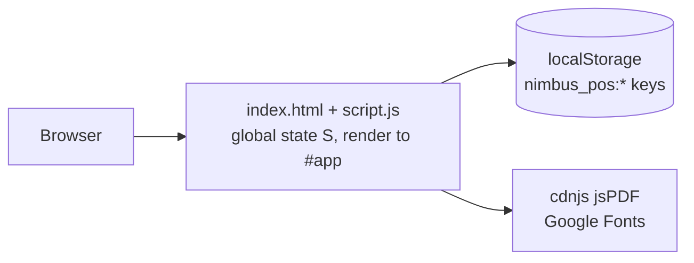
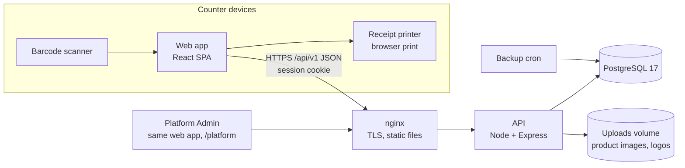

# Architecture — POS SYSTEM

## 1. System overview

### 1.1 Current prototype



Everything — all businesses, users, passwords and sales — lives in one browser. `render()` rebuilds the whole screen from strings after every change, and `db.set()` rewrites whole collections. This is why the prototype can't be secured or shared between devices (D-01).

### 1.2 v1 target



One web app serves three areas: public (landing, register, sign-in), the business app (`/app/*`) and the platform admin (`/platform/*`). The API is the only thing that touches the database; the browser holds only the current cart.

## 2. Components

| Component | Responsibility | Talks to |
|---|---|---|
| `apps/web` | Screens, navigation by role and business type, POS cart and live totals (via shared engine), receipt print/PDF, i18n | API |
| `apps/api` | Authentication, sessions, tenant isolation, permissions, plan and subscription gating, all business rules, numbering, persistence, reports, audit log, CSV import/export, image upload | PostgreSQL, uploads volume |
| `packages/shared` | Money engine (BR-12 to BR-16), amount in words (BR-37), enums and labels, permission matrix, plan limits, Zod request schemas, shared TypeScript types | Imported by web and api |
| PostgreSQL | All persistent data (`06-BACKEND-SCHEMA.md`) | API |
| nginx | TLS, gzip, serves web build, proxies `/api` and `/uploads` | API |
| Backup cron | Nightly `pg_dump` and uploads sync off-server | PostgreSQL |

## 3. Folder structure

```
pos-system/
├── CLAUDE.md                     # entry file for Claude Code
├── docs/                         # these specs (source of truth)
├── prototype/                    # original vanilla JS app — READ-ONLY reference, never deployed
├── docker-compose.yml            # local: postgres; prod: nginx + api + postgres + backup
├── .env.example
├── package.json                  # pnpm workspace root scripts
├── pnpm-workspace.yaml
├── packages/
│   └── shared/
│       └── src/
│           ├── money/            # engine.ts (computeLine, allocateDiscounts, computeSale), words.ts, format.ts
│           ├── enums.ts          # all enums + English labels (match 06-BACKEND-SCHEMA.md §4)
│           ├── permissions.ts    # role → permissions (implements 05-SECURITY-ACCESS.md §3)
│           ├── plans.ts          # plan prices, limits, gated features (02-BUSINESS-RULES.md §3.6)
│           ├── business-types.ts # customer types, order types per business type (§3.5)
│           ├── schemas/          # Zod schemas for every API request body
│           └── index.ts
├── apps/
│   ├── api/
│   │   ├── prisma/
│   │   │   ├── schema.prisma
│   │   │   ├── migrations/
│   │   │   └── seed.ts           # platform admin; demo businesses when SEED_DEMO_BUSINESSES=true
│   │   ├── src/
│   │   │   ├── server.ts         # starts HTTP server
│   │   │   ├── app.ts            # builds Express app; middleware order in §5
│   │   │   ├── config/env.ts     # Zod-validated environment variables
│   │   │   ├── db/               # prisma client + tenant-scoping extension
│   │   │   ├── middleware/       # session, csrf, requireEmployee, requirePermission, requireActiveSubscription, requirePlanFeature, idempotency, errorHandler
│   │   │   ├── lib/              # counters.ts, audit.ts, time.ts (Asia/Thimphu), csv.ts, uploads.ts, errors.ts
│   │   │   └── modules/          # one folder per resource: routes.ts, controller.ts, service.ts
│   │   │       ├── auth/  registration/  subscription/  employees/  me/
│   │   │       ├── products/  inventory/  purchases/  suppliers/
│   │   │       ├── sales/  held-orders/  kitchen/  payments/  customers/
│   │   │       ├── expenses/  settings/  reports/  dashboard/  audit/  data/
│   │   │       └── platform/
│   │   └── test/                 # Vitest + Supertest, one file per module
│   └── web/
│       ├── public/fonts/         # self-hosted Manrope, IBM Plex Mono, Noto Sans Tibetan
│       ├── src/
│       │   ├── main.tsx  App.tsx  router.tsx
│       │   ├── styles/           # tokens.css, base.css, print.css (from prototype/style.css)
│       │   ├── i18n/             # index.ts, en.json, dz.json
│       │   ├── api/              # client.ts (fetch wrapper, CSRF header, error mapping) + hooks per resource
│       │   ├── components/       # shared UI: Button, Field, Input, Select, Modal, DataTable, Pill, KpiCard, Toast, AlertBanner, EmptyState, BarChart, DonutChart, Barcode
│       │   ├── layouts/          # AuthLayout, AppShell (sidebar + topbar), PlatformLayout
│       │   ├── features/         # one folder per screen group (pages + their components)
│       │   │   ├── auth/  register/  dashboard/  pos/  receipt/  kitchen/  products/  inventory/  purchases/
│       │   │   ├── invoices/  payments/  gst/  reports/  customers/  suppliers/  expenses/  users/  audit/
│       │   │   └── subscription/  settings/  platform/
│       │   ├── stores/cart.ts    # Zustand POS cart (sessionStorage)
│       │   └── lib/              # receiptPdf.ts, useNetworkStatus.ts, can.ts (permission checks for UI)
│       └── e2e/                  # Playwright tests
└── .github/workflows/ci.yml
```

### Prototype → v1 map

Use this to find the reference behavior for anything you build.

| Prototype (`prototype/script.js`) | v1 location |
|---|---|
| `computeLineTax`, `computeBillAdjust`, `effectiveCart`, `cartTotals`, `round2` | `packages/shared/src/money/engine.ts` (rules changed slightly: BR-14, BR-16) |
| `amountInWords`, `numberToWords`, `money` | `packages/shared/src/money/words.ts`, `format.ts` |
| `PLANS`, `ROLES`, `ROLE_SCREENS`, `roleCanAccess` | `packages/shared/src/plans.ts`, `permissions.ts` |
| `CUSTOMER_TYPES`, order type lists, `KITCHEN_STATUSES`, `PAYMENT_METHOD_TYPES`, `BHUTAN_BANKS` | `packages/shared/src/business-types.ts`, `enums.ts` |
| `handleRegisterSubmit`, `activateSubscription` | `apps/api/src/modules/registration` + `features/register` |
| `handleCompanyLogin`, `handleEmployeeLogin`, `logout`, `boot` (remember) | `modules/auth` + `features/auth` |
| `subStatusOf`, `subAllowsAccess`, `requiresActiveSub`, `ensureSubscription` | `modules/subscription` + `middleware/requireActiveSubscription` |
| `screenPos`, `addToCart`, `scanAdd`, `searchEnter`, `holdOrder`, `openAddPaymentLine` | `features/pos` + `stores/cart.ts` + `modules/held-orders` |
| `completeSale` | `modules/sales/service.ts → completeSale` (server, one transaction) |
| `voidTxn` | `modules/sales/service.ts → voidSale` |
| `screenReceipt`, `downloadReceiptPdf`, `barcodeBarsHTML`, `gstBreakdown` | `features/receipt` + `lib/receiptPdf.ts` + `components/Barcode` |
| `screenOrders`, `setOrderStatus`, `openSendToKitchenModal`, `loadKitchenOrderIntoCart` | `modules/kitchen` + `features/kitchen` + `features/pos` |
| `screenProducts`, `openProductModal`, `handleImportFile`, `exportCollectionCsv`, `generateProductBarcode` | `modules/products` + `features/products` |
| `screenInventory`, `openStockModal`, `lowStockItems`, `productTracksStock` | `modules/inventory` + `features/inventory` |
| `screenGst`, `exportGstCsv`, `quickRange`, `inRange` | `modules/reports` (gst) + `features/gst` |
| `screenPayments`, `exportPaymentsCsv` | `modules/reports` (payments) + `features/payments` |
| `screenReports`, `estimatedProfitFor` | `modules/reports` (sales) + `features/reports` |
| `screenDashboard`, `DASHBOARD_ROLE_VIEW`, `dashboardCharts` | `modules/dashboard` + `features/dashboard` |
| `screenCustomers`, `openReceivePaymentModal`, `viewCustomerHistory` | `modules/customers` + `features/customers` |
| `screenSettings` (tax, pricing, logo, backup) | `modules/settings`, `modules/data` + `features/settings` |
| `screenSubscription`, `openSubscriptionPayment` | `modules/subscription` + `features/subscription` |
| `screenSaasAdmin`, `adminExtendTrial`, `adminSuspend`, `adminReactivate` | `modules/platform` + `features/platform` |
| `logAudit`, `screenAudit` | `lib/audit.ts` + `modules/audit` + `features/audit` |
| `ensureDemoBusinesses`, `demo*For` | `apps/api/prisma/seed.ts` (F-25) |
| `I18N`, `t()` | `apps/web/src/i18n/dz.json` (needs native review) |

## 4. Data flow

### 4.1 Sign-in

```mermaid
sequenceDiagram
    participant U as Employee
    participant W as Web
    participant A as API
    participant D as DB
    U->>W: Company name or BIZ-ID + company password
    W->>A: POST /auth/company-login
    A->>D: find business (case-insensitive), verify argon2 hash
    A-->>W: 200 {business}; sets device cookie (remember 30 days if ticked)
    U->>W: Username + password
    W->>A: POST /auth/employee-login
    A->>D: find active employee in that business, verify hash, rate-limit
    A->>D: create session row; audit "Login"
    A-->>W: 200 {employee, permissions, subscription}; sets session cookie
    W->>W: route to role home (08-APP-FLOW.md §2)
```

### 4.2 Complete a sale (BR-21)

```mermaid
sequenceDiagram
    participant C as Cashier
    participant W as Web (POS)
    participant A as API
    participant D as DB
    C->>W: scan items, payments, "Complete sale"
    W->>W: shared engine computes totals (preview)
    W->>A: POST /sales (lines, discounts, customer, charges, payments, expectedTotal) + Idempotency-Key
    A->>A: check session, permission sale.create, active subscription
    A->>D: BEGIN
    A->>D: SELECT products ... FOR UPDATE (current price, rate, stock)
    A->>A: shared engine recomputes; PRICE_CHANGED / PAYMENT_MISMATCH / INSUFFICIENT_STOCK checks
    A->>D: UPDATE counters (invoice, year) RETURNING value
    A->>D: INSERT sale, sale_items, payments, stock_movements
    A->>D: UPDATE products.stock, customers balances, kitchen_orders
    A->>D: INSERT audit_logs
    A->>D: COMMIT
    A-->>W: 201 {sale with invoice_no}
    W->>W: clear cart, open receipt (/app/sales/:id)
```

### 4.3 Void a sale (BR-24)

Same pattern in one transaction: lock the sale row, check status `completed`, set `voided`, insert `void_restock` movements for tracked lines, update product stock, set payments `voided`, adjust the customer, unbill the kitchen order, write the audit log.

## 5. Layering & conventions

- **Request pipeline (API):** `helmet` → `cors` → JSON body (1 MB limit) → `session` → `csrf` (all non-GET) → route → `requireEmployee` (or `requirePlatformAdmin`) → `requirePermission('<permission>')` → `requireActiveSubscription` (for gated routes, BR-05) → `requirePlanFeature('<feature>')` (BR-07) → controller → service → Prisma → `errorHandler`.
- **Controllers** only parse and validate input (Zod schema from `packages/shared`), call one service function, and shape the response. No business logic.
- **Services** hold all business rules, reference rule IDs in comments (`// BR-24`), and wrap multi-row writes in `prisma.$transaction`.
- **Tenant isolation (D-04):** the session gives `ctx = { businessId, employeeId, role, plan }`. Every service takes `ctx`. A Prisma client extension requires `businessId` in the `where` of every query on tenant models and throws `TenantScopeError` otherwise. Never accept `businessId` from the request body or URL in business routes.
- **Money:** only `packages/shared/src/money` computes tax, discounts and totals. The web uses it for live preview; the API uses it as the authority and stores its output. Never write tax math anywhere else.
- **Numbering:** only `lib/counters.ts → nextNumber(tx, businessId, name, year?)` issues invoice, KOT, CR and PUR numbers, inside the caller's transaction.
- **Audit:** `lib/audit.ts → audit(tx, ctx, action, entity, detail)` inside the same transaction as the change.
- **Web data fetching:** TanStack Query hooks in `src/api/`; components never call `fetch` directly. Mutations invalidate the affected queries.
- **Web state:** server data in TanStack Query; POS cart in the Zustand store; everything else is local component state. No global mutable object like the prototype's `S`.
- **Permissions in the UI:** `can(permission)` from `lib/can.ts` (reads the permissions returned at sign-in) hides navigation and buttons. The API enforces the same permissions; hiding is never the only check.
- **Dates:** the API converts business-day ranges to UTC using `lib/time.ts` (Asia/Thimphu). The web sends dates as `YYYY-MM-DD` and times as `HH:mm` and never does time-zone math.

## 6. Error handling & logging

- Services throw `AppError(code, httpStatus, message, details?)`. Unknown errors become `500 INTERNAL_ERROR` with a request ID; the stack trace is logged, never returned.
- Error response shape and codes: `07-API-SPEC.md` §1–2.
- Web API client: `401` → go to sign-in; `403 SUBSCRIPTION_INACTIVE` → blocked screen; `403 FORBIDDEN` → back to dashboard with toast "Your role doesn't have access to that."; `409`/`422` → show `message` inline or as a toast; network failure → offline bar (`03-TRD.md` §3).
- A React error boundary per route shows "Something went wrong loading this page" with a "Back to dashboard" button (as prototype).
- pino logs one JSON line per request (method, path, status, duration, businessId, employeeId, requestId). Never log passwords, session IDs, CSRF tokens or full request bodies.

## 7. Background jobs, realtime & caching

- **Scheduled jobs:** only the nightly backup container. Subscription expiry is computed on each request (BR-04), so no expiry job is needed. `connect-pg-simple` prunes expired sessions.
- **Realtime:** none in v1. The kitchen board polls `GET /kitchen-orders` every 5 seconds, the POS "Bill a kitchen order" list every 10 seconds, and the dashboard every 60 seconds (TanStack Query `refetchInterval`), only while the screen is visible.
- **Caching:** no server cache. Static web assets get long-lived cache headers with hashed file names; `index.html` is never cached.
