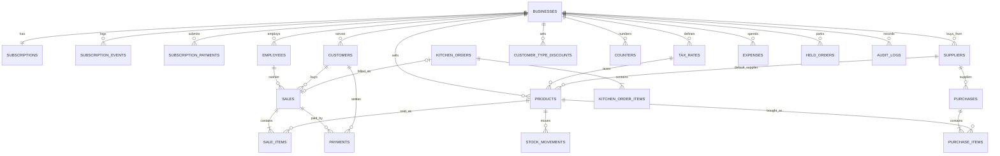

# Backend Schema — POS SYSTEM

PostgreSQL 17 via Prisma. Who may read or write which rows is defined in `05-SECURITY-ACCESS.md`; §7 below says how the data layer enforces it.

## 1. Conventions

- **Naming:** tables and columns `snake_case`, tables plural. Prisma models are PascalCase singular mapped with `@@map("table")`; Prisma fields are camelCase mapped with `@map("column")`. API JSON uses camelCase.
- **Primary keys:** `id uuid` default `gen_random_uuid()`, except `sessions.sid`, `counters` and `customer_type_discounts` (composite keys).
- **Timestamps:** `created_at timestamptz not null default now()` on every table; `updated_at timestamptz` on every editable table (Prisma `@updatedAt`). All timestamps are UTC.
- **Business day:** `business_date date` on sales, payments and expenses holds the Asia/Thimphu date (BR-33), so reports filter on an indexed column.
- **Money:** `numeric(12,2)`. Percentages: `numeric(5,2)`. Quantities and stock: `integer` (no weighed items in v1).
- **Tenant key:** every tenant table has `business_id uuid not null references businesses(id)`, and every index used by lists starts with `business_id`.
- **Deletes:** no hard deletes except `held_orders`, `expenses`, `idempotency_keys` and expired `sessions`. Everything else uses `active` or a status.
- **Snapshots:** sale lines copy name, barcode, category, price, tax rate/mode/category and unit cost, so history never changes when products change.

## 2. ER diagram

## 3. Tables

### Platform

#### `platform_admins`

| Column | Type | Null | Default | Notes |
|---|---|---|---|---|
| id | uuid | No | gen_random_uuid() | PK |
| email | text | No | — | Unique, stored lowercase |
| name | text | No | — | |
| password_hash | text | No | — | argon2id |
| totp_secret_enc | text | Yes | — | Encrypted (`TOTP_ENCRYPTION_KEY`) |
| totp_enabled | boolean | No | false | |
| must_change_password | boolean | No | true | |
| active | boolean | No | true | |
| last_login_at | timestamptz | Yes | — | |
| created_at, updated_at | timestamptz | No | now() | |

#### `businesses`

| Column | Type | Null | Default | Notes |
|---|---|---|---|---|
| id | uuid | No | gen_random_uuid() | PK |
| business_code | text | No | — | `BIZ-XXXXX`, unique (BR-01) |
| name | text | No | — | As typed |
| name_key | text | No | — | `lower(trim(name))`, unique (BR-01) |
| type | business_type | No | — | |
| owner_name | text | No | — | |
| phone | text | No | — | |
| email | text | No | — | |
| address | text | Yes | — | |
| gst_no | text | Yes | — | Business TPN / GST no. |
| gst_registered | boolean | No | false | BR-11; true if `gst_no` given at registration |
| logo_path | text | Yes | — | Under `UPLOAD_DIR`; null = default Yuevaan logo |
| password_hash | text | No | — | Company password (argon2id) |
| must_change_password | boolean | No | false | Set after a platform reset |
| is_demo | boolean | No | false | Seeded demo business (F-25) |
| created_at, updated_at | timestamptz | No | now() | |

- **Indexes:** unique(business_code), unique(name_key).

#### `subscriptions`

| Column | Type | Null | Default | Notes |
|---|---|---|---|---|
| id | uuid | No | gen_random_uuid() | PK |
| business_id | uuid | No | — | FK businesses, unique (one per business) |
| plan | plan_code | No | — | |
| status | subscription_status | No | 'trial' | Effective status computed per BR-04 |
| started_at | timestamptz | No | now() | |
| expires_at | timestamptz | No | — | |
| created_at, updated_at | timestamptz | No | now() | |

#### `subscription_events`

| Column | Type | Null | Default | Notes |
|---|---|---|---|---|
| id | uuid | No | gen_random_uuid() | PK |
| business_id | uuid | No | — | FK |
| event | subscription_event_type | No | — | |
| plan | plan_code | Yes | — | Plan at the time |
| amount | numeric(12,2) | Yes | — | |
| detail | text | Yes | — | e.g. "Extended to 2027-01-09" |
| actor_employee_id | uuid | Yes | — | FK employees |
| actor_platform_admin_id | uuid | Yes | — | FK platform_admins |
| created_at | timestamptz | No | now() | |

- **Indexes:** (business_id, created_at desc).

#### `subscription_payments`

| Column | Type | Null | Default | Notes |
|---|---|---|---|---|
| id | uuid | No | gen_random_uuid() | PK |
| business_id | uuid | No | — | FK |
| plan | plan_code | No | — | Plan being paid for |
| amount | numeric(12,2) | No | — | Plan price at submission |
| method | subscription_payment_method | No | — | |
| bank_name | text | Yes | — | Required for `bank_transfer` |
| reference | text | No | — | Journal / transaction number |
| paid_on | date | No | — | |
| status | subscription_payment_status | No | 'pending' | |
| submitted_by | uuid | No | — | FK employees |
| reviewed_by | uuid | Yes | — | FK platform_admins |
| reviewed_at | timestamptz | Yes | — | |
| reject_reason | text | Yes | — | |
| created_at | timestamptz | No | now() | |

- **Indexes:** (status, created_at) for the platform queue; (business_id, created_at desc).

### Identity

#### `employees`

| Column | Type | Null | Default | Notes |
|---|---|---|---|---|
| id | uuid | No | gen_random_uuid() | PK |
| business_id | uuid | No | — | FK |
| username | text | No | — | As typed |
| username_key | text | No | — | `lower(username)`; unique with business_id (BR-02) |
| name | text | No | — | Shown on receipts as cashier |
| role | employee_role | No | — | |
| password_hash | text | No | — | |
| must_change_password | boolean | No | false | True after an Admin reset |
| language | ui_language | No | 'en' | F-24 |
| active | boolean | No | true | |
| failed_login_count | integer | No | 0 | Lockout (05 §1) |
| locked_until | timestamptz | Yes | — | |
| last_login_at | timestamptz | Yes | — | |
| created_at, updated_at | timestamptz | No | now() | |

- **Indexes:** unique(business_id, username_key); (business_id, role, active).

#### `sessions`

Standard `connect-pg-simple` table: `sid varchar primary key`, `sess json not null`, `expire timestamp(6) not null`, index on `expire`. The `sess` JSON holds `{ kind: 'employee' | 'platform', businessId?, employeeId?, platformAdminId?, csrf }`. Created by its own SQL migration (not a Prisma model).

### Catalogue & stock

#### `tax_rates`

| Column | Type | Null | Default | Notes |
|---|---|---|---|---|
| id | uuid | No | gen_random_uuid() | PK |
| business_id | uuid | No | — | FK |
| name | text | No | — | e.g. "GST Standard" |
| rate | numeric(5,2) | No | — | 0–100 |
| mode | tax_mode | No | 'exclusive' | |
| category | tax_category | No | 'standard' | BR-10 |
| effective_date | date | No | — | Informational in v1 |
| active | boolean | No | true | |
| is_default | boolean | No | false | |
| created_at, updated_at | timestamptz | No | now() | |

- **Indexes:** (business_id, active); partial unique `(business_id) where is_default` (raw SQL migration).

#### `products`

| Column | Type | Null | Default | Notes |
|---|---|---|---|---|
| id | uuid | No | gen_random_uuid() | PK |
| business_id | uuid | No | — | FK |
| name | text | No | — | |
| category | text | No | 'Uncategorized' | Free text, grouped in lists |
| barcode | text | No | — | BR-08 |
| image_path | text | Yes | — | Under `UPLOAD_DIR` |
| purchase_price | numeric(12,2) | No | 0 | Copied to `sale_items.unit_cost` |
| sell_price | numeric(12,2) | No | — | > 0 |
| tax_rate_id | uuid | No | — | FK tax_rates |
| unit | product_unit | No | 'pc' | |
| track_stock | boolean | No | true | BR-09 |
| stock | integer | No | 0 | Changed only via stock movements (BR-25); check ≥ 0 |
| min_stock | integer | No | 0 | |
| supplier_id | uuid | Yes | — | FK suppliers |
| batch_no | text | Yes | — | |
| expiry_date | date | Yes | — | |
| active | boolean | No | true | |
| created_at, updated_at | timestamptz | No | now() | |

- **Indexes:** unique(business_id, barcode); (business_id, active, name); (business_id, category); trigram index on name for search (`pg_trgm`).
- **Check:** `stock >= 0`, `sell_price > 0`, `purchase_price >= 0`.

#### `stock_movements`

| Column | Type | Null | Default | Notes |
|---|---|---|---|---|
| id | uuid | No | gen_random_uuid() | PK |
| business_id | uuid | No | — | FK |
| product_id | uuid | No | — | FK |
| type | movement_type | No | — | BR-25 |
| qty | integer | No | — | Signed (+ in, − out); never 0 |
| stock_after | integer | No | — | Product stock after this movement |
| reason | text | Yes | — | Required for `adjustment` |
| sale_id | uuid | Yes | — | FK sales (sale, void_restock) |
| purchase_id | uuid | Yes | — | FK purchases |
| created_by | uuid | Yes | — | FK employees; null for imports by system |
| created_at | timestamptz | No | now() | |

- **Indexes:** (business_id, product_id, created_at desc); (business_id, created_at desc).

#### `suppliers`

| Column | Type | Null | Default | Notes |
|---|---|---|---|---|
| id | uuid | No | gen_random_uuid() | PK |
| business_id | uuid | No | — | FK |
| name | text | No | — | |
| phone | text | Yes | — | |
| email | text | Yes | — | |
| address | text | Yes | — | |
| notes | text | Yes | — | |
| opening_paid | numeric(12,2) | No | 0 | From prototype `amountPaid` |
| opening_outstanding | numeric(12,2) | No | 0 | From prototype `amountOutstanding` |
| active | boolean | No | true | |
| created_at, updated_at | timestamptz | No | now() | |

Supplier totals (computed, not stored): paid = opening_paid + Σ purchases.amount_paid; outstanding = opening_outstanding + Σ (purchases.total − purchases.amount_paid) (BR-38).

#### `purchases` (F-09)

| Column | Type | Null | Default | Notes |
|---|---|---|---|---|
| id | uuid | No | gen_random_uuid() | PK |
| business_id | uuid | No | — | FK |
| purchase_no | text | No | — | `PUR-YYYY-NNNNN`; unique per business |
| supplier_id | uuid | No | — | FK |
| purchase_date | date | No | — | |
| total | numeric(12,2) | No | — | Σ line totals |
| amount_paid | numeric(12,2) | No | 0 | ≤ total |
| note | text | Yes | — | |
| created_by | uuid | No | — | FK employees |
| created_at | timestamptz | No | now() | |

#### `purchase_items`

| Column | Type | Null | Default | Notes |
|---|---|---|---|---|
| id | uuid | No | gen_random_uuid() | PK |
| purchase_id | uuid | No | — | FK |
| business_id | uuid | No | — | FK |
| product_id | uuid | No | — | FK |
| qty | integer | No | — | ≥ 1 |
| unit_cost | numeric(12,2) | No | — | Becomes product purchase price |
| line_total | numeric(12,2) | No | — | qty × unit_cost |
| batch_no | text | Yes | — | |
| expiry_date | date | Yes | — | |

### Customers

#### `customers`

| Column | Type | Null | Default | Notes |
|---|---|---|---|---|
| id | uuid | No | gen_random_uuid() | PK |
| business_id | uuid | No | — | FK |
| name | text | No | — | |
| type | customer_type | No | 'regular' | Must be valid for the business type (BR-35, 02 §3.5) |
| phone | text | Yes | — | |
| email | text | Yes | — | |
| address | text | Yes | — | |
| gst_id | text | Yes | — | Customer TPN, printed on invoices |
| credit_limit | numeric(12,2) | Yes | — | null = no limit set |
| total_spent | numeric(12,2) | No | 0 | Updated by sales and voids |
| outstanding_balance | numeric(12,2) | No | 0 | Check ≥ 0 |
| notes | text | Yes | — | |
| active | boolean | No | true | |
| created_at, updated_at | timestamptz | No | now() | |

- **Indexes:** (business_id, active, name); (business_id, phone).
- There is no Walk-in customer row: `customer_id = null` on a sale means Walk-in.

#### `customer_type_discounts`

| Column | Type | Null | Default | Notes |
|---|---|---|---|---|
| business_id | uuid | No | — | PK part, FK |
| customer_type | customer_type | No | — | PK part |
| discount_pct | numeric(5,2) | No | 0 | 0–100 (BR-34) |
| updated_at | timestamptz | No | now() | |

### Sales

#### `sales`

| Column | Type | Null | Default | Notes |
|---|---|---|---|---|
| id | uuid | No | gen_random_uuid() | PK |
| business_id | uuid | No | — | FK |
| invoice_no | text | No | — | `INV-YYYY-NNNNN` (BR-23) |
| invoice_year | integer | No | — | |
| invoice_seq | integer | No | — | |
| status | sale_status | No | 'completed' | |
| completed_at | timestamptz | No | now() | |
| business_date | date | No | — | BR-33 |
| cashier_id | uuid | No | — | FK employees |
| customer_id | uuid | Yes | — | FK customers; null = Walk-in |
| customer_type | customer_type | Yes | — | Snapshot |
| order_type | order_type | No | — | |
| table_no | text | Yes | — | |
| kitchen_order_id | uuid | Yes | — | FK kitchen_orders, unique |
| gst_registered | boolean | No | — | Snapshot of BR-11 |
| subtotal | numeric(12,2) | No | — | 02 §3.1 |
| discount_total | numeric(12,2) | No | 0 | Line + allocated |
| customer_type_pct | numeric(5,2) | No | 0 | |
| customer_type_amt | numeric(12,2) | No | 0 | |
| bill_discount_type | bill_discount_type | Yes | — | |
| bill_discount_value | numeric(12,2) | No | 0 | As typed (% or Nu.) |
| bill_discount_amt | numeric(12,2) | No | 0 | |
| taxable_amount | numeric(12,2) | No | — | |
| tax_amount | numeric(12,2) | No | — | |
| charges | numeric(12,2) | No | 0 | BR-15 |
| total | numeric(12,2) | No | — | Grand total |
| amount_paid | numeric(12,2) | No | — | Non-credit payments |
| credit_amount | numeric(12,2) | No | 0 | |
| payment_summary | text | No | — | Method label, or "Split" |
| voided_at | timestamptz | Yes | — | |
| voided_by | uuid | Yes | — | FK employees |
| void_reason | text | Yes | — | |
| created_at | timestamptz | No | now() | |

- **Indexes:** unique(business_id, invoice_no); unique(business_id, invoice_year, invoice_seq); (business_id, business_date); (business_id, status, completed_at); (business_id, customer_id, completed_at desc); (business_id, cashier_id, business_date).
- **Checks:** `amount_paid + credit_amount = total`; `taxable_amount + tax_amount + charges = total`.

#### `sale_items`

| Column | Type | Null | Default | Notes |
|---|---|---|---|---|
| id | uuid | No | gen_random_uuid() | PK |
| sale_id | uuid | No | — | FK |
| business_id | uuid | No | — | FK |
| line_no | integer | No | — | 1-based, cart order |
| product_id | uuid | No | — | FK |
| name | text | No | — | Snapshot |
| barcode | text | No | — | Snapshot |
| category | text | No | — | Snapshot (sales by category) |
| unit_price | numeric(12,2) | No | — | |
| qty | integer | No | — | ≥ 1 |
| line_discount | numeric(12,2) | No | 0 | |
| allocated_discount | numeric(12,2) | No | 0 | 02 §3.2 |
| tax_rate | numeric(5,2) | No | — | Snapshot (0 if not GST-registered) |
| tax_mode | tax_mode | No | — | Snapshot |
| tax_category | tax_category | No | — | Snapshot |
| taxable | numeric(12,2) | No | — | |
| tax | numeric(12,2) | No | — | |
| total | numeric(12,2) | No | — | taxable + tax |
| unit_cost | numeric(12,2) | No | 0 | Snapshot of purchase_price (BR-32) |
| track_stock | boolean | No | — | Snapshot, used by void (BR-24) |

- **Indexes:** (sale_id, line_no) unique; (business_id, product_id).

#### `payments`

| Column | Type | Null | Default | Notes |
|---|---|---|---|---|
| id | uuid | No | gen_random_uuid() | PK |
| business_id | uuid | No | — | FK |
| kind | payment_kind | No | — | `sale` or `credit_settlement` |
| sale_id | uuid | Yes | — | Required when kind = sale |
| receipt_no | text | Yes | — | `CR-NNNN` when kind = credit_settlement |
| customer_id | uuid | Yes | — | Required for credit and settlements |
| method | payment_method | No | — | BR-17 |
| amount | numeric(12,2) | No | — | > 0 |
| cash_received | numeric(12,2) | Yes | — | Cash only (BR-18) |
| change_given | numeric(12,2) | Yes | — | |
| fee | numeric(12,2) | No | 0 | Optional handling fee noted by cashier (prototype "charges" on a payment line); informational, not in totals |
| bank_name | text | Yes | — | From the bank list in `enums.ts` |
| journal_no | text | Yes | — | Bank journal no. or wallet transaction ID |
| remarks | text | Yes | — | |
| status | payment_status | No | 'completed' | |
| business_date | date | No | — | |
| created_by | uuid | No | — | FK employees |
| created_at | timestamptz | No | now() | |
| voided_at | timestamptz | Yes | — | |

- **Indexes:** (business_id, business_date, status); (business_id, sale_id); (business_id, customer_id, kind); unique(business_id, receipt_no) where receipt_no is not null.

#### `counters`

| Column | Type | Null | Default | Notes |
|---|---|---|---|---|
| business_id | uuid | No | — | PK part |
| name | counter_name | No | — | PK part |
| year | integer | No | 0 | PK part; 0 for counters that never reset |
| value | integer | No | 0 | Last number issued |

Incremented with `UPDATE … SET value = value + 1 … RETURNING value` (row inserted on first use) inside the caller's transaction (`04-ARCHITECTURE.md` §5).

#### `kitchen_orders`

| Column | Type | Null | Default | Notes |
|---|---|---|---|---|
| id | uuid | No | gen_random_uuid() | PK |
| business_id | uuid | No | — | FK; restaurant businesses only |
| order_no | text | No | — | `KOT-NNNN`, unique per business |
| order_type | order_type | No | — | dine_in, takeaway, delivery, pre_ordered |
| table_no | text | Yes | — | |
| note | text | Yes | — | Kitchen note |
| status | kitchen_status | No | 'new' | BR-27 |
| billed | boolean | No | false | |
| sale_id | uuid | Yes | — | FK sales |
| customer_id | uuid | Yes | — | FK customers |
| created_by | uuid | No | — | FK employees |
| status_changed_at | timestamptz | No | now() | |
| created_at, updated_at | timestamptz | No | now() | |

- **Indexes:** unique(business_id, order_no); (business_id, status, created_at).

#### `kitchen_order_items`

| Column | Type | Null | Default | Notes |
|---|---|---|---|---|
| id | uuid | No | gen_random_uuid() | PK |
| kitchen_order_id | uuid | No | — | FK |
| business_id | uuid | No | — | FK |
| product_id | uuid | No | — | FK |
| name | text | No | — | Snapshot |
| qty | integer | No | — | ≥ 1 |

#### `held_orders`

| Column | Type | Null | Default | Notes |
|---|---|---|---|---|
| id | uuid | No | gen_random_uuid() | PK |
| business_id | uuid | No | — | FK |
| label | text | No | — | "Held 14:32 — Sonam" |
| payload | jsonb | No | — | `HeldOrderPayload` Zod schema in `packages/shared` (BR-29) |
| created_by | uuid | No | — | FK employees |
| created_at | timestamptz | No | now() | |

### Other

#### `expenses`

| Column | Type | Null | Default | Notes |
|---|---|---|---|---|
| id | uuid | No | gen_random_uuid() | PK |
| business_id | uuid | No | — | FK |
| name | text | No | — | |
| category | expense_category | No | — | |
| amount | numeric(12,2) | No | — | > 0 |
| business_date | date | No | — | Expense date |
| payment_method | expense_payment_method | No | 'cash' | |
| description | text | Yes | — | |
| created_by | uuid | No | — | FK employees |
| created_at, updated_at | timestamptz | No | now() | |

- **Indexes:** (business_id, business_date).

#### `audit_logs`

| Column | Type | Null | Default | Notes |
|---|---|---|---|---|
| id | uuid | No | gen_random_uuid() | PK |
| business_id | uuid | Yes | — | Null only for platform-wide actions (e.g. creating a platform admin) |
| actor_employee_id | uuid | Yes | — | FK employees |
| actor_platform_admin_id | uuid | Yes | — | FK platform_admins |
| actor_name | text | No | — | Snapshot ("system" for imports) |
| action | text | No | — | From the list in `05-SECURITY-ACCESS.md` §7 |
| entity_type | text | Yes | — | e.g. "sale" |
| entity_id | text | Yes | — | |
| detail | text | Yes | — | e.g. "INV-2026-00042 — Nu. 376.43 (Split)" |
| created_at | timestamptz | No | now() | |

- **Indexes:** (business_id, created_at desc); (business_id, action, created_at desc). No update or delete is ever issued.

#### `idempotency_keys`

| Column | Type | Null | Default | Notes |
|---|---|---|---|---|
| business_id | uuid | No | — | PK part |
| key | text | No | — | PK part; from `Idempotency-Key` header |
| employee_id | uuid | No | — | |
| route | text | No | — | e.g. "POST /sales" |
| status_code | integer | No | — | |
| response | jsonb | No | — | Body returned the first time |
| created_at | timestamptz | No | now() | Rows older than 24 h are deleted on insert |

## 4. Enums

Database values on the left; English labels live in `packages/shared/src/enums.ts`.

| Enum | Values |
|---|---|
| business_type | grocery, restaurant |
| plan_code | starter, professional, enterprise |
| subscription_status | trial, active, suspended, cancelled (expired is computed, BR-04) |
| subscription_event_type | registered, plan_changed, payment_submitted, payment_verified, payment_rejected, cancelled, extended, suspended, reactivated |
| subscription_payment_method | bank_transfer, mbob, mpay, tpay, dk_bank, other_wallet |
| subscription_payment_status | pending, verified, rejected |
| employee_role | admin, manager, cashier, accountant, inventory_officer, storekeeper, waiter, kitchen_staff |
| ui_language | en, dz |
| tax_mode | exclusive, inclusive |
| tax_category | standard, zero_rated, exempt |
| product_unit | pc, kg, g, l, ml, plate, box |
| movement_type | opening_stock, purchase, stock_in, stock_out, adjustment, sale, void_restock |
| customer_type | regular, vip, corporate, wholesale, retail, credit, government_institutional, online, delivery |
| order_type | walk_in, dine_in, takeaway, delivery, pre_ordered, pre_booked |
| kitchen_status | new, accepted, preparing, ready, served, cancelled (matches `02-BUSINESS-RULES.md` §4.1) |
| sale_status | completed, voided (matches §4.2) |
| bill_discount_type | percent, amount |
| payment_method | cash, card, mbob, mpay, dk_bank, tpay, other_wallet, bank, credit |
| payment_kind | sale, credit_settlement |
| payment_status | completed, voided |
| expense_category | rent, utilities, salaries, supplies, maintenance, marketing, other |
| expense_payment_method | cash, card, bank_transfer, mobile_wallet, other |
| counter_name | invoice, kot, credit_settlement, purchase |

Bank list (text, not an enum, so banks can be added without a migration): Bank of Bhutan, Bhutan National Bank, Bhutan Development Bank, Druk PNB Bank, T Bank, DK Bank.

## 5. Relationships & integrity

| Relationship | Type | On delete |
|---|---|---|
| subscriptions.business_id → businesses.id | one-to-one | restrict |
| employees.business_id → businesses.id | many-to-one | restrict |
| products.tax_rate_id → tax_rates.id | many-to-one | restrict |
| products.supplier_id → suppliers.id | many-to-one | set null |
| stock_movements.product_id → products.id | many-to-one | restrict |
| sales.cashier_id → employees.id | many-to-one | restrict |
| sales.customer_id → customers.id | many-to-one | restrict |
| sales.kitchen_order_id → kitchen_orders.id | one-to-one | restrict |
| sale_items.sale_id → sales.id | many-to-one | cascade (sales are never deleted) |
| payments.sale_id → sales.id | many-to-one | restrict |
| purchases.supplier_id → suppliers.id | many-to-one | restrict |
| purchase_items.purchase_id → purchases.id | many-to-one | cascade |
| kitchen_order_items.kitchen_order_id → kitchen_orders.id | many-to-one | cascade |
| Every tenant table's business_id → businesses.id | many-to-one | restrict |

Cross-tenant references are impossible by design: services load referenced rows (product, customer, supplier, tax rate) through the tenant-scoped layer before linking them, so an ID from another business returns `NOT_FOUND`.

## 6. Auth & sessions storage

- Passwords: `businesses.password_hash`, `employees.password_hash`, `platform_admins.password_hash` (argon2id).
- Sessions: `sessions` table (§3, Identity), managed by `connect-pg-simple`; expired rows pruned automatically.
- Lockout counters: `employees.failed_login_count`, `employees.locked_until`. Company-step and IP limits are in memory (`express-rate-limit`, single API instance in v1).
- The `device` cookie holds only a signed business ID and expiry; no table.

## 7. Access rules

- **Tenant scope:** a Prisma client extension (`apps/api/src/db/tenant.ts`) wraps every query on tenant models and throws if `where.businessId` (or `data.businessId` on create) is missing or differs from `ctx.businessId`. Tests call every list endpoint as two businesses and compare results (AC-58).
- **Role scope:** row filtering beyond the tenant applies only to Waiter receipts (`sales.cashier_id = ctx.employeeId`, `05-SECURITY-ACCESS.md` §4).
- **Platform scope:** platform routes use a separate query module that can read only `businesses`, `subscriptions`, `subscription_events`, `subscription_payments`, `platform_admins`, `audit_logs` and a count of active `employees`.
- **Row-level security:** not in v1 (D-04).

## 8. Migrations & seed data

- **Migrations:** Prisma Migrate, folder `apps/api/prisma/migrations`. Raw SQL migrations for: `pgcrypto` and `pg_trgm` extensions, the `sessions` table, partial unique indexes, check constraints. Every schema change updates this doc in the same commit.
- **Seed (`pnpm --filter api db:seed`):**
  - Always: the first Platform Admin from `PLATFORM_ADMIN_EMAIL` / `PLATFORM_ADMIN_INITIAL_PASSWORD`.
  - Only when `SEED_DEMO_BUSINESSES=true` and `NODE_ENV` isn't `production` (F-25): the four prototype demo businesses — Pema Store and Norbu General Store (grocery), Test Restaurant and Menjong Kitchen (restaurant) — with the same owners, contacts, products, customers (all types), suppliers, expenses and customer-type discounts as `ensureDemoBusinesses()` in the prototype; one employee per role (`admin`, `manager1`, `cashier1`, `accountant1`, `inventoryofficer1`, `storekeeper1`, `waiter1`, `kitchenstaff1`) with the password from `SEED_DEMO_PASSWORD`; Professional plan active for 30 days; 30 days of sales generated with a seeded random generator through the real `completeSale` service, so all totals follow the v1 rules.
  - **Seed data fix:** rice, cooking oil and salt products use the "GST Exempt 0%" rate (02 §8); restaurant `plate` items get `track_stock = false`.

### Prototype backup → v1 import mapping (F-21)

The prototype backup is `{ app: "POS SYSTEM", version: 1, business: {...}, collections: {...} }`.

| Prototype collection | v1 table | Notes |
|---|---|---|
| `business` | businesses (update profile only) | Name, type, gstNo, address, phone, email; `logo` data URL saved as an image file |
| `subscription` | — | Ignored; the v1 subscription stays as is |
| `taxrates` | tax_rates | `mode` kept; category = `zero_rated` if rate 0 else `standard`; IDs remapped |
| `users` | employees | Passwords **not** imported: random temporary password, `must_change_password = true`; role names mapped ("Inventory Officer" → `inventory_officer`); duplicate usernames (case-insensitive) suffixed `-2` |
| `products` | products + one `opening_stock` movement each | `sellPrice` → sell_price, `purchasePrice` → purchase_price, `taxId` remapped, `image` data URL → file, `track_stock` per BR-09; blank or duplicate barcodes regenerated |
| `inventory` | stock_movements (history only) | Imported as history with original dates; product stock comes from `products.stock` via the opening movement, not by replaying |
| `customers` | customers | The "Walk-in Customer" record is skipped; its sales get `customer_id = null`; type labels mapped to enum |
| `suppliers` | suppliers | `amountPaid`/`amountOutstanding` → opening_paid/opening_outstanding; `contact` split into phone/email when recognisable |
| `expenses` | expenses | `note` → name when `name` missing; "Kitchen supplies"/"Store supplies" → `supplies` |
| `transactions` | sales + sale_items | Numbers kept as-is (`invoice_seq` parsed); lines keep their stored tax values (not recomputed); status Voided → `voided`; `cashier` name matched to an employee or to the importing Admin |
| `payments` | payments | Method labels mapped ("mBoB" → `mbob`, "Mobile Payment" → `other_wallet`); `kind: 'Credit settlement'` → `credit_settlement` |
| `counters` | counters | invoice counter set to the highest imported number for the current year |
| `orders` | kitchen_orders + items | `status` mapped; "Pre-order" → `pre_ordered` |
| `auditLogs` | audit_logs | `actor_name` from `by` |
| `heldOrders` | — | Ignored |
| `pricing` | customer_type_discounts | Keys mapped to enum |

Import runs in one transaction, refuses if the business already has sales, and reports counts per table.
