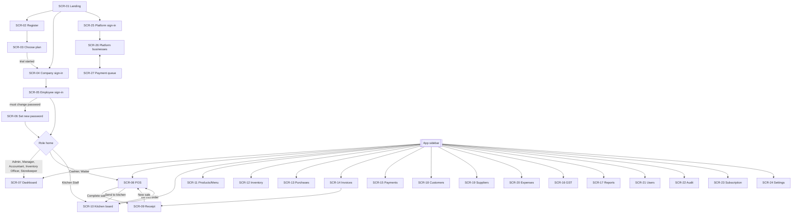

# App Flow — POS SYSTEM

Screens carry over from the prototype (function names in brackets) with the changes marked **v1 change**. Who sees each screen is defined by permissions in `05-SECURITY-ACCESS.md` §3; plan gating by BR-07; subscription gating by BR-05.

## 1. Screen inventory

| ID | Screen | Route | Roles (permission) | Purpose | Features |
|---|---|---|---|---|---|
| SCR-01 | Landing (`screenLanding`) | `/` | Public | Choose register, company sign-in or platform admin | F-01, F-03 |
| SCR-02 | Register — business details (`screenRegister`) | `/register` | Public | Enter business details and password | F-01 |
| SCR-03 | Register — choose plan (`screenSubscribe`) | `/register/plan` | Public | Pick plan, start 14-day trial | F-01, F-02 |
| SCR-04 | Company sign-in (`screenCompanyLogin`) | `/login` | Public | Step 1 of sign-in | F-03 |
| SCR-05 | Employee sign-in (`screenEmployeeLogin`) | `/login/employee` | Device cookie | Step 2 of sign-in | F-03 |
| SCR-06 | Set new password | `/change-password` | Employee with `mustChangePassword` | Forced password change | F-03, F-04 |
| SCR-07 | Dashboard (`screenDashboard`) | `/app` | `dashboard.view` | Role lens (`05` §4) | F-05 |
| SCR-08 | POS (`screenPos`) | `/app/pos` | `pos.sell` | Billing | F-10, F-11, F-17 |
| SCR-09 | Receipt (`screenReceipt`) | `/app/sales/:id` | `sales.view` | View, print, PDF, void | F-12, F-13 |
| SCR-10 | Kitchen board (`screenOrders`) | `/app/kitchen` | `kitchen.view`, restaurant | Ticket statuses | F-11 |
| SCR-11 | Products / Menu (`screenProducts`) | `/app/products` | `products.view` | Catalogue, import/export | F-06, F-07 |
| SCR-12 | Inventory (`screenInventory`) | `/app/inventory` | `inventory.view` | Stock, movements, alerts | F-08 |
| SCR-13 | Purchases | `/app/purchases` | `purchases.manage`, grocery | Supplier purchases (**v1 change:** prototype showed Inventory here) | F-09 |
| SCR-14 | Invoices (`screenInvoices`) | `/app/sales` | `sales.view` (not Waiter) | Search and open invoices | F-13 |
| SCR-15 | Payments report (`screenPayments`) | `/app/reports/payments` | `payments.view` | Totals by method, records | F-15 |
| SCR-16 | GST report (`screenGst`) | `/app/reports/gst` | `reports.gst` | GST figures for any range | F-14 |
| SCR-17 | Sales report (`screenReports`) | `/app/reports/sales` | `reports.sales` | Sales, profit, charts | F-16 |
| SCR-18 | Customers (`screenCustomers`) | `/app/customers` | `customers.view` | Customers, credit, history | F-17 |
| SCR-19 | Suppliers (`screenSuppliers`) | `/app/suppliers` | `suppliers.view` | Suppliers and balances | F-18 |
| SCR-20 | Expenses (`screenExpenses`) | `/app/expenses` | `expenses.view` | Record expenses | F-19 |
| SCR-21 | Users (`screenUsers`) | `/app/users` | `employees.manage` | Employees and roles | F-04 |
| SCR-22 | Audit log (`screenAudit`) | `/app/audit` | `audit.view` | Activity history | F-22 |
| SCR-23 | Subscription (`screenSubscription`) | `/app/subscription` | `subscription.manage` | Plan, status, payment, history | F-02 |
| SCR-24 | Settings (`screenSettings`) | `/app/settings` | `settings.manage` or `data.export_import` | Profile, logo, tax rates, customer discounts, data | F-20, F-21 |
| SCR-25 | Platform sign-in (`screenSaasAdminLogin`) | `/platform/login` | Public | Email + password + TOTP | F-23 |
| SCR-26 | Platform — businesses (`screenSaasAdmin`) | `/platform` | Platform Admin | List, detail, actions | F-23 |
| SCR-27 | Platform — payment queue | `/platform/payments` | Platform Admin | Verify or reject subscription payments | F-23, F-02 |

The language toggle (F-24) is part of SCR-01, SCR-04, SCR-05 and the app sidebar, not a screen.

## 2. Navigation map

- **App shell (as prototype `shell`):** left sidebar 224 px (brand "POS SYSTEM", business name, nav items, footer with employee name, role, "Log out" and language toggle); top bar with screen title, "Grocery · BIZ-XXXXX" and the subscription status badge.
- **Sidebar order:** Dashboard, POS, then Kitchen Orders + Menu (restaurant) or Products + Purchases (grocery), Inventory (with low-stock count badge), Invoices, Payments, Customers, Suppliers, Expenses, GST / Tax, Reports, Users, Audit Log, Subscription, Settings. Items are shown only if the role has the permission, the business type matches and the plan includes the feature.
- **Mobile (< 768 px, v1 change):** sidebar becomes a slide-in drawer opened from a menu button in the top bar.
- **Role home after sign-in (v1 change):** Cashier and Waiter → POS; Kitchen Staff → Kitchen board; everyone else → Dashboard (prototype sent everyone to Dashboard).
- **No permission for a route:** redirect to the role home with toast "Your role (Cashier) doesn't have access to that screen." (as prototype `go`).
- **Subscription inactive on a gated screen (BR-05):** the content area shows the blocked card: "Subscription Expired — This feature is restricted while your subscription is inactive." with "Renew or upgrade" (Admin) or "Ask your Admin to renew" (others).
- **Not signed in:** any `/app/*` route → SCR-04 (or SCR-05 if the device is remembered), then back to the requested route after sign-in.

## 3. Key user journeys

### J1 — Register and make the first sale (grocery)
1. SCR-01 → "Register a new business" → SCR-02: name, type Grocery, owner, phone, email, TPN (optional), address, password ×2 → "Continue".
2. SCR-03: plan cards (Starter, Professional selected by default, Enterprise) → "Start 14-day free trial".
3. Toast "Your trial has started. Sign in to continue." → SCR-04 with Business ID prefilled → SCR-05 (`admin` prefilled) → SCR-07 Dashboard with empty states.
4. Sidebar → Products → "+ Add product" → fill in → saved; repeat or import CSV (Professional).
5. Sidebar → POS → scan → pay → Complete sale → SCR-09 → "Print receipt".

### J2 — Daily sign-in on a remembered till
1. Open the app → `GET /auth/device` finds the remembered company → SCR-05 shows the business name and logo.
2. Cashier enters username and password → POS.
3. At shift change: "Log out" → back to SCR-05; the next cashier signs in.

### J3 — Grocery split payment
1. SCR-08: scan 4 items; set qty of one to 3 with the + button.
2. Select customer "Karma Wangchuk · VIP" → "VIP Customer pricing (5%)" row appears and totals update.
3. "+ Add payment" → Cash, amount 200.00, cash received 500.00 → line shows "Cash received 500.00 · Change 300.00"; toast "Change to return: Nu. 300.00".
4. "+ Add payment" → mBoB, amount prefilled with the remaining balance, Txn ID → Balance shows Nu. 0.00 in teal.
5. "Complete sale" → SCR-09 receipt → Print.

### J4 — Restaurant dine-in through the kitchen
1. Waiter, SCR-08: order type Dine-in, Table "4", add dishes → "Send to kitchen (no bill yet)" → modal (order type, table, kitchen note) → KOT-0042 created → SCR-10 with toast "KOT-0042 sent to kitchen."
2. Kitchen Staff, SCR-10: card in New → "→ Accepted" → "→ Preparing" → "→ Ready".
3. Waiter or Cashier: on the Ready card "Bill this order" (or POS "Bill a kitchen order" dropdown) → SCR-08 with the items in the cart and the table set.
4. Add payment → Complete sale → order moves to Served, billed → SCR-09.

### J5 — Credit sale and settlement
1. SCR-08: select customer "Dorji Tshering · Credit Customer"; "+ Add payment" → Credit, amount = total. If over the credit limit, a warning toast appears after completion (BR-19).
2. Later, SCR-18: row shows Outstanding in red → "Receive payment" → amount, method mPay, Txn ID → toast "Nu. 1,000.00 received from Dorji Tshering. Balance: Nu. 2,200.00." → history panel opens showing receipt CR-0007.

### J6 — Void a wrong invoice
1. Manager, SCR-14 → search "INV-2026-00042" → "View" → SCR-09.
2. "Void invoice" → modal "Void INV-2026-00042? This restores stock, cancels its payments and updates the customer's balance." + reason (required) → "Void invoice".
3. Receipt shows a red VOID stamp with time, who and reason; status pill "Voided"; toast "Invoice INV-2026-00042 voided. Stock and accounts adjusted."

### J7 — Month-end GST
1. Accountant, SCR-16 → "Last month" → KPIs, daily table, rate table and transactions update.
2. "Export CSV" on each table, or "Print" → printable report.

### J8 — Renew a subscription
1. Admin sees the top-bar warning "Your subscription expires in 5 days. Renew now." → SCR-23 → "Pay & renew" → modal: method (Bank transfer / mBoB / mPay / TPay / DK Bank / Other wallet), bank (if bank transfer), reference, paid on → "Submit payment".
2. Pending payment appears with status "Awaiting verification".
3. Platform Admin, SCR-27 → "Verify" → business becomes Active with new expiry (BR-06).

### J9 — Working with an expired subscription
1. Cashier signs in → POS shows the blocked card "Ask your Admin to renew".
2. Admin signs in → Dashboard and Settings work; Subscription → J8.

## 4. Screen details

**Standard states (every screen):**
- **Loading:** skeleton rows in tables, skeleton blocks for KPI cards; buttons that submit show a spinner and are disabled.
- **Empty:** the empty-state message listed per screen below, plus one action button where the role can act.
- **Error:** loading failures show an inline card "Couldn't load this. Check your connection and try again." with "Retry"; action failures show the API `message` inline (forms) or as a toast.
- **Success:** a toast (bottom-right, 2.6 s, as prototype) with the message listed per screen; the table refreshes.
- **Modals:** close with ✕, Cancel, Esc or a backdrop click (unsaved form → confirm "Discard changes?"). Focus is trapped inside; it returns to the opener on close.

### SCR-04 Company sign-in
- **Components:** logo, "Welcome back", progress bar, "Company name or Business ID", password with Show/Hide, "Remember this device" checkbox (unchecked by default — **v1 change**), "Continue securely →", links "Create an account" and "← Back", language toggle.
- **Actions:** Continue → `POST /auth/company-login` → SCR-05 · failure → inline "Business not found or incorrect password." · locked → "Too many attempts. Try again in 15 minutes."
- **States:** Loading: button spinner. Empty/Success: N/A.

### SCR-05 Employee sign-in
- **Components:** business logo and name, "Employee sign-in · Stage 2 of 2", username, password with Show/Hide, "Sign in →", "← Different company" (clears device), language toggle. If the subscription is inactive: red notice "Subscription is Expired." with "Reactivate account" (visible to all; leads to sign-in as Admin).
- **v1 change:** username isn't prefilled with `admin`; the hint "the default administrator ID is admin" is removed; no demo credentials anywhere.
- **Actions:** Sign in → role home, or SCR-06 if `mustChangePassword` · failure → "Incorrect username or password." · locked → as SCR-04.

### SCR-07 Dashboard
- **Components by lens (`05` §4):** KPI rows (Today's Sales, Today's Orders, Today's Profit, GST Collected Today / Pending Orders, Total Customers), (Total Products, Total Customers, Pending Orders, Today's Expenses), (Low Stock Items, Out-of-Stock Items); low-stock alert table (top 8, "Open inventory"); grocery snapshot (Inventory Value, Fast-Moving Today, Recent Purchases, Low Stock) or restaurant floor (Active Tables, Pending Kitchen Orders, Dine-in, Takeaway); charts (Sales trend — last 7 recorded days; Payment mix — today); Top-selling products; Payment method breakdown (today); Recent transactions (6, "View all"); Open kitchen tickets (floor lens). Non-full lenses show "Showing a Cashier-focused view of the dashboard."
- **Empty:** "No sales recorded yet." / "No payments today." / "No transactions yet — go to POS to record your first sale." / "No open kitchen tickets right now."
- **Refresh:** every 60 s while visible.

### SCR-08 POS
- **Left column:**
  - Low-stock banner: "⚠ 3 item(s) low on stock: Sugar 1kg (4 kg), … View inventory →" (only with `inventory.view`, otherwise without the link).
  - Scan box (autofocus, placeholder "Scan or type barcode, press Enter…"): Enter → exact barcode or exact name match → add 1; no match → toast `No product matches "<value>".`
  - Search box ("Search products… (Enter adds a single match)"): filters the product table as you type; Enter → exact match or the single remaining result is added; several → toast "5 products match — refine the search or click Add."
  - Restaurant: "Bill a kitchen order" card with a dropdown of billable orders ("Dine-in — Table 4 · 3 item(s) · Ready") and "Manage kitchen orders →".
  - Held orders card (if any): "Held 14:32 — Sonam · 3 item(s) · Nu. 540.00" with Resume / Delete (confirm).
  - Product table: Product, Barcode, Price, Stock (red with ⚠ when low; "—" when not tracked), Add (disabled when tracked and stock ≤ 0).
- **Right column — Billing card:**
  - Cart table: Item, Qty (− / input / +, min 1), Disc (Nu.), Total, ✕. Empty: "Cart is empty."
  - Summary: Subtotal; Item discounts; "<Customer type> pricing (x%) − amount" (when applicable); Discount [% | Nu.] + value; "Bill discount applied − amount"; Taxable amount; GST (hidden if not GST-registered); Charges (input); **Grand total**.
  - Order type select (per business type, BR-35) + "Table #" for Dine-in.
  - Customer select with search: "Walk-in" default, then "Name · phone".
  - Payments: "+ Add payment" → modal; lines table (Method, Amount, Detail, ✕); "Paid (cash/bank)"; "Credit / outstanding" (if any); "Balance due" (red) / "Overpaid" (red) / "Balance" (teal at 0.00).
  - Buttons: "Send to kitchen (no bill yet)" (restaurant, cart not empty, not billing a kitchen order); "Hold order"; "Cancel order" (confirm "Clear this cart?"); "Complete sale" (enabled when cart not empty, balance is exactly 0.00 and online). Under it, when disabled with items: "Payments must add up exactly to the grand total before completing the sale."
- **Add payment modal:** Method (Cash, Card, mBoB, mPay, DK Bank, TPay, Other wallet, Bank, Credit); Amount (prefilled with remaining balance); Cash received (Cash only); Fee (optional); Bank name (Bank only, select); Journal No. / Transaction ID (required for Bank and wallets); Remarks. Errors: "Select a customer before adding a credit payment.", "Cash received is less than the amount owed.", "Enter the transaction ID."
- **Complete sale →** `POST /sales` →
  - Success: cart cleared, go to SCR-09; warnings shown as one toast ("Note: this sale pushes Dorji Tshering over their credit limit of Nu. 10,000.00. Low stock: Sugar 1kg (2 left).").
  - `PRICE_CHANGED`: affected lines update to the new price, toast "Prices changed for 1 item. Check the new total.", payments stay.
  - `INSUFFICIENT_STOCK`: toast with the API message; lines highlighted red.
  - `SUBSCRIPTION_INACTIVE`: blocked card replaces the POS (cart kept in session storage).
- **Offline:** red bar at the top "Offline — sales can't be completed. Your cart is kept."; Complete sale disabled.
- **Focus:** after any add, modal close or toast, focus returns to the scan box (as prototype `render`).

### SCR-09 Receipt
- **Components:** buttons "Print receipt", "Download PDF", "Back to invoices" (if `sales.view` list), "New sale" (if `pos.sell`), "Void invoice" (if `sales.void` and completed); 80 mm receipt per BR-36; voided sales show a diagonal "VOID" stamp and "Voided <date time> by <name>: <reason>".
- **Print:** `window.print()` with print CSS showing only the receipt (`#print-area`).
- **PDF:** jsPDF 80 mm, same content, file `INV-2026-00042.pdf`. If jsPDF fails: toast "PDF couldn't be created — use Print receipt instead."
- **Empty/Error:** unknown or other-business ID → "Invoice not found." with "Back to invoices".

### SCR-10 Kitchen board
- **Components:** six columns New, Accepted, Preparing, Ready, Served, Cancelled with counts; cards show KOT no., "Dine-in · T4", minutes since sent, items "2× Ema Datshi", kitchen note (amber); buttons "→ <next status>", "Cancel" (confirm), "Bill this order" (Ready/Served, not billed, with `pos.sell`). Served and Cancelled show today's orders only.
- **Empty column:** "—". **Whole board empty:** "No kitchen orders yet. Orders sent from the POS appear here."
- **Refresh:** polls every 5 s. **Tablet/mobile:** columns scroll horizontally, each min 220 px.

### SCR-11 Products / Menu
- **Title:** "Products" (grocery) or "Menu" (restaurant); noun "product" / "menu item" throughout.
- **Toolbar:** search ("Search by name or barcode…"), "Download CSV template", "Import CSV", "Export CSV" (plan-gated; labels say CSV, **v1 change** from "Excel"), "+ Add product".
- **Table grouped by category** (heading with count): photo or initial letter, name (+ "inactive" pill), barcode, purchase price, selling price, GST %, stock ("Not tracked" when untracked; red when low), Edit.
- **Product modal:** name, photo, barcode ("Auto-generated if left blank"), category (type-ahead from existing), purchase price, selling price, GST rate (select of active rates — **v1 change** from free-typed %), unit, track stock (checkbox, default per BR-09), opening stock (create only), minimum stock, supplier, batch number, expiry date, active (edit only).
- **Import result card:** "Import complete — 120 created, 14 updated, 3 rows skipped." with the first 5 errors.
- **Empty:** "No products yet. Add one manually or import from CSV." / "No products match your search."
- **Success toasts:** "Product saved.", "Products imported."

### SCR-12 Inventory
- **Toolbar:** "+ Stock in / out / adjustment".
- **Sections:** "Expiring soon (within 30 days)" (Product, Batch, Expiry date — amber, red with "(expired)", Stock); "Current stock" (Product, Stock, Min, Batch, Expiry, Status pill: Out of stock / Low stock / OK / Not tracked); "Stock movement history" (Date, Product, Type, Qty with sign, Reason, By; 50 per page).
- **Movement modal:** Product (tracked only), Type (Stock in, Stock out, Adjustment), Quantity (positive), Increase/Decrease (adjustment only), Reason (required for adjustment), Batch number and Expiry date (stock in only).
- **Errors:** "Only 5 in stock." **Success:** "Inventory updated."
- **Empty:** "No products yet." / "No stock movements recorded yet."

### SCR-13 Purchases (grocery)
- **List:** Purchase no., Date, Supplier, Items, Total, Paid, Outstanding; "+ Record purchase".
- **Purchase modal (wide):** Supplier, Date, item rows (product search, qty, unit cost, batch, expiry, line total, ✕, "+ Add item"), Amount paid, Note, Total.
- **Empty:** "No purchases recorded yet." **Success:** "Purchase PUR-2026-00012 recorded. Stock updated."

### SCR-14 Invoices
- **Toolbar:** search ("Search invoice no., customer…"), date range (default last 30 days), status filter.
- **Table:** Invoice, Date & time, Customer, Total, GST, Status pill, View (and Void for `sales.void` — opens SCR-09's void modal).
- **Empty:** "No invoices yet."

### SCR-15 Payments report
- **Filters:** Today, Yesterday, This week, This month, This year; From / To dates.
- **KPI cards:** one per method with an amount, plus "On credit" and "Credit settlements".
- **Table:** Date & time, Invoice / Receipt, Method, Amount, Bank / Journal, Remarks, By. "Export CSV".
- **Empty:** "No payments in this range."

### SCR-16 GST report
- **Filters:** Today, Yesterday, This week, Last week, This month, Last month, This year; From date, From time, To date, To time; "Clear filter".
- **KPIs:** Total Sales, Taxable Sales, GST Collected, Transactions; Discounts, Voided, Net Sales (**v1 change:** "Refunds" KPI removed — no refunds in v1).
- **Tables:** Daily breakdown; GST rate breakdown (Rate, Category, Taxable, GST); Transactions in range. Each with "Export CSV"; "Print" prints the whole report (print CSS for `#print-area` on this screen — fixes the prototype's blank print).
- **Notes:** "GST rates are locked to the rate active at the time of sale…" (as prototype). If not GST-registered: banner "This business isn't GST-registered. Invoices are issued without GST."
- **Empty:** "No transactions in this range."

### SCR-17 Sales report
- **Filters:** From / To.
- **KPIs:** Gross Sales, Transactions, Avg. Transaction, Estimated Profit; note "Estimated profit = sales before GST − cost of goods sold (purchase price at time of sale) − expenses in range."
- **Charts:** Revenue by date, Sales by category, Profit trend (red bars for losses). Starter: charts hidden, upgrade note.
- **Tables:** Sales by employee / cashier; Sales by category.
- **Empty:** "No sales in range."

### SCR-18 Customers
- **Toolbar:** search, type filter, "+ Add customer"; card "Total credit outstanding: Nu. 5,300.00 across 2 customer(s)".
- **Table:** Name (+ inactive pill), Type, Phone, Total spent, Credit limit, Outstanding (red if > 0), actions History, Edit, Receive payment (if outstanding > 0 and `customers.settle`).
- **History panel:** KPIs (Total spending, Outstanding credit, Credit limit); invoices table (Invoice, Date, Total, Paid, Credit, Status); "Payments received against credit" (Date, Receipt, Method, Amount, Details).
- **Empty:** "No customers yet." / "No purchases yet." / "No balance payments recorded yet."
- **Success:** "Customer added.", "Nu. 1,000.00 received from <name>. Balance: Nu. 2,200.00."

### SCR-19 Suppliers
- **Table:** Name, Contact (phone · email), Paid, Outstanding, Edit (with `suppliers.manage`); "+ Add supplier".
- **Empty:** "No suppliers yet." **Success:** "Supplier saved."

### SCR-20 Expenses
- **Toolbar:** date range (default this month), "Total in range" KPI, "+ Record expense".
- **Table:** Date, Name, Category, Amount, Payment, By, Edit / Delete (confirm).
- **Empty:** "No expenses recorded yet." **Success:** "Expense recorded."

### SCR-21 Users
- **Toolbar:** "+ Add employee"; plan note "Starter plan: 1 of 1 employees used."
- **Table:** Name, Username, Role, Status pill (Active / Disabled), Edit, Reset password, Disable / Enable.
- **Errors:** "Username already taken.", "A business must keep at least one active Admin.", "Your plan allows 10 employees. Upgrade to add more."
- **Success:** "Employee added." / "Password reset. Give the temporary password to <name>."

### SCR-22 Audit log
- **Filters:** action, employee, date range. **Table:** When, By, Action, Detail (200 per page).
- **Empty:** "No activity recorded yet."

### SCR-23 Subscription
- **Banners:** ≤ 7 days left: "⚠ Your subscription expires in N days. Renew now."; expired: "⚠ Your subscription expired N days ago. Renew now."
- **Cards:** Plan, Status badge, Subscription started, Subscription ends (N days left / expired).
- **Sections:** "Benefits you're currently availing"; "Change plan" (3 plan cards, "Current plan" pill or "Switch to X"); "Payments" (pending/verified/rejected list); "Actions" ("Pay & renew", "Cancel subscription" with confirm); "History" (Event, Date, Amount).
- **v1 change:** "Simulate expiration" and "Recommended upgrades" removed; the card/CVV form is replaced by the reference form (J8).

### SCR-24 Settings
- **Sections:** Business profile (owner, phone, email, address, TPN, "GST-registered" switch with explanation of BR-11); Business logo (preview, Change, Use default); Tax rates table (Name, Rate, Mode, Category, Default ★, Effective from, Status, Activate/Deactivate, Set default) + "Add tax rate"; Customer-type pricing (one % input per type except Walk-in, saved on change with toast "VIP Customer: 5% automatic discount saved."); Data (Download JSON export; "Import prototype backup" with confirm "This adds all data from the backup file. It can only be done before your first sale.").
- **Note under tax rates:** "Changing or deactivating a rate only affects future sales — every past invoice keeps the rate it was sold at."

### SCR-25 to SCR-27 Platform
- **SCR-25:** email, password, 6-digit code; first sign-in → set password → scan QR to enrol TOTP.
- **SCR-26:** search + status filter; table Business, Type, Business ID, Owner, Plan, Status badge, Expires, Employees; row click → detail panel with subscription history, payments and buttons "Extend 14 days", "Suspend" (confirm), "Reactivate", "Reset company password". Empty: "No businesses registered yet."
- **SCR-27:** pending payments (Business, Plan, Amount, Method, Bank, Reference, Paid on, Submitted) with "Verify" and "Reject" (reason required). Empty: "No payments waiting for verification."

## 5. System flows

| Flow | Trigger | Steps | Result |
|---|---|---|---|
| Subscription check | Every API request by an employee | Load subscription, compute effective status (BR-04); gated route + inactive → `SUBSCRIPTION_INACTIVE` | Web shows the blocked card (BR-05) |
| Expiry warning | `GET /auth/me` returns `daysLeft ≤ 7` | Top bar shows a warning to Admins | Admin can renew early (J8) |
| Session expiry | 12 h absolute or 2 h idle (`05` §1) | Next request → `401` | Web goes to SCR-05 with "Your session expired. Please sign in again."; POS cart kept in session storage |
| Employee disabled / role changed | Admin action | Next request reloads employee | Disabled → signed out with "Your account was disabled."; role change → permissions refresh |
| Low-stock badge | After any sale, stock movement or purchase | Inventory alerts query refetched | Sidebar badge count updates |
| Kitchen board refresh | Every 5 s while SCR-10 is visible | `GET /kitchen-orders` | New tickets appear |
| Offline detection | `navigator.onLine` false or a request fails with a network error | Show offline bar; disable Complete sale | Recovers automatically when online |
| Checkout retry | Network error during `POST /sales` | Retry up to 3 times with the same Idempotency-Key | Exactly one invoice (`02` §7) |
| Nightly backup | 02:00 BTT cron | `pg_dump` + uploads sync off-server | 30 daily copies kept (`03-TRD.md` §5) |
| Cleanup | On insert / hourly | Delete expired sessions and idempotency keys older than 24 h | Tables stay small |
